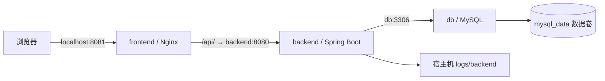

# BookManageSystem · 图书管理系统

基于 Vue 3、Spring Boot 和 MySQL 的前后端分离项目，支持图书新增、查询、更新、删除，以及按角色控制操作权限。前后端已对接真实数据库，可在本机开发，也可使用 Docker Compose 运行前端、后端和数据库三个服务。

## 功能

- 图书管理：浏览列表、按编号查询、新增、更新、删除前二次确认。
- 表单校验：校验书名、作者、价格和描述，展示后端返回的字段错误。
- 身份认证：登录、退出、查询当前用户，通过 Session 和 Cookie 维持登录状态。
- 权限控制：普通读者、图书管理员、系统管理员三种角色；前端路由和导航配合后端接口授权。
- CSRF 防护：登录、退出及图书写操作携带后端提供的 CSRF 令牌。
- 日志排查：请求编号、接口耗时、安全事件、异常堆栈和数据库业务操作记录。
- 接口文档：通过 springdoc 提供 OpenAPI 和 Swagger UI。
- 容器部署：Nginx 承载前端并代理 API，MySQL 数据卷持久化，后端文件日志挂载到宿主机。

当前登录账号由后端 `InMemoryUserDetailsManager` 创建，尚未接入数据库用户表，也没有用户注册或账号管理功能。后端重启后，已有登录会话需要重新建立。

## 技术栈

| 层次 | 使用技术 |
| --- | --- |
| 前端 | Vue 3、Vue Router 4、Vite 8|
| 后端 | Java 17、Spring Boot 4.1.2、Spring MVC、Spring Security |
| 数据访问 | Spring JDBC / JdbcTemplate、MySQL 8.0、事务管理 |
| 参数校验 | Jakarta Bean Validation |
| 日志 | SLF4J、Logback、MDC |
| 测试 | JUnit、Mockito、MockMvc |
| 构建与部署 | Maven、npm、Docker Compose、Nginx |

后端打包为可通过 `java -jar` 启动的 WAR。依赖版本以 [pom.xml](pom.xml)、[frontend/package.json](frontend/package.json) 和锁文件为准。

## 项目结构

```text
BookManageSystem/
├─ frontend/
│  ├─ src/
│  │  ├─ api/                 # 登录与图书接口请求封装
│  │  ├─ router/              # 路由及角色访问检查
│  │  ├─ views/               # 登录、工作台、图书操作页面
│  │  ├─ App.vue              # 应用布局、导航、退出登录
│  │  └─ style.css            # 页面样式
│  ├─ nginx.conf              # 前端路由回退及 /api/ 反向代理
│  ├─ vite.config.js          # 本机开发代理
│  └─ Dockerfile              # 前端多阶段构建
├─ src/main/java/com/example/bookmanagesystem/
│  ├─ config/                 # Spring Security 配置
│  ├─ controller/             # HTTP 接口
│  ├─ dto/                    # 请求字段及校验规则
│  ├─ entity/                 # 图书实体
│  ├─ service/                # 业务处理与事务
│  ├─ repository/             # JDBC 数据访问、操作日志入库
│  ├─ filter/                 # 请求编号、耗时及请求日志
│  ├─ exception/              # 统一异常响应与异常日志
│  └─ db/db.sql               # 首次建库建表脚本
├─ src/main/resources/application.properties
├─ src/test/                  # 后端自动化测试
├─ .env.example               # 环境配置模板，不存放真实密码
├─ compose.yaml               # db、backend、frontend 三个服务
├─ Dockerfile                 # 后端多阶段构建
├─ Dockerfile.runtime         # 本机打包 WAR 后的备用镜像构建
├─ DOCKER.md                  # 完整部署、代理和容器排错步骤
├─ LOGGING.md                 # 日志保存、关联和检索说明
└─ README.md
```

## 环境配置

以下示例以 Windows PowerShell 为例，除特别注明外均在项目根目录执行。Linux/macOS 使用 `mvn`、`npm` 替代 `mvn.cmd`、`npm.cmd`。

本机开发需要 JDK 17、Maven 3.9、Node.js 24、npm，以及启用 Linux 容器的 Docker Desktop / Docker Compose。使用标准多阶段 Docker 构建时，宿主机只需 Docker 环境，Java 和 Node 构建工具由镜像提供。

首次运行时创建配置文件，已有 `.env` 时不要覆盖：

```powershell
if (-not (Test-Path .env)) { Copy-Item .env.example .env }
notepad .env
```

填写下面的变量；密码需要替换成自己的值：

| 变量 | 作用 | 默认端口或使用说明 |
| --- | --- | --- |
| `MYSQL_ROOT_PASSWORD` | 初始化 MySQL root 密码 | 仅用于数据库管理和健康检查 |
| `MYSQL_PASSWORD` | 初始化 `book_app` 用户密码 | 也是本机后端数据库密码的回退值 |
| `MYSQL_PORT` | 数据库映射到宿主机的端口 | `3307` |
| `BACKEND_PORT` | Docker 后端映射到宿主机的端口 | `8080` |
| `FRONTEND_PORT` | Docker 前端映射到宿主机的端口 | `8081` |
| `DEMO_READER_PASSWORD` | `reader` 登录密码 | 自行设置 |
| `DEMO_LIBRARIAN_PASSWORD` | `librarian` 登录密码 | 自行设置 |
| `DEMO_ADMIN_PASSWORD` | `admin` 登录密码 | 自行设置 |

根目录 `.env` 已被 Git 忽略。请填写全部必填密码，即使只启动 `db`，Compose 也会解析文件中其他服务的必填变量。

本机后端通过 `spring.config.import=optional:file:./.env[.properties]` 按 Java properties 格式读取工作目录中的 `.env`，现有 `@Value` 可以直接读取其中的配置，无需在 IDEA 重复填写。建议使用双方都兼容的简单 `KEY=value` 格式，不加引号，避免使用依赖 dotenv 专有引号、转义或插值规则的写法。

后端还支持 `DB_URL`、`DB_USERNAME`、`DB_PASSWORD` 覆盖数据库配置。Docker Compose 会直接注入这些变量，让容器中的后端连接 `db:3306`；它们的环境变量值优先于配置文件。

`BACKEND_PORT` 只控制 Docker 端口映射，本机 Java 服务当前仍监听 `8080`；`FRONTEND_PORT` 只控制 Nginx 映射端口，不控制 Vite 开发服务器。

## 本机开发：前后端本机运行，数据库使用 Docker

连接关系：浏览器 → Vite `/api` 代理 → 本机后端 `8080` → 数据库容器映射端口 `3307`。

### 1. 启动数据库

如果之前已经启动过前后端容器，先停止它们，避免与本机服务端口冲突：

```powershell
docker compose stop frontend backend
docker compose config --quiet
docker compose up -d db
docker compose ps db
```

等待 `db` 显示 `healthy`。首次使用空数据目录启动时，MySQL 自动执行 `db.sql`。默认连接参数为：

```text
主机：127.0.0.1
端口：3307（以 .env 的 MYSQL_PORT 为准）
数据库：book_manage_system
用户：book_app
密码：.env 中的 MYSQL_PASSWORD
```

### 2. 启动后端

在项目根目录的新终端运行：

```powershell
mvn.cmd spring-boot:run
```

也可以在 IDEA 中启动 `BookManageSystemApplication`，工作目录设置为项目根目录，以便找到 `.env`。后端默认地址为 `http://localhost:8080`，Swagger UI 为 `http://localhost:8080/docs`。

### 3. 启动前端

在另一个终端执行：

```powershell
cd frontend
npm.cmd ci
npm.cmd run dev
```

访问终端显示的地址，默认是 `http://localhost:5173/login`。如果 5173 被占用，以 Vite 实际输出为准。前端的 `/api` 请求会由 Vite 转发至 `http://localhost:8080`。

## Docker 部署：运行全部三个服务

容器连接关系如下，浏览器通过 Nginx 统一入口访问前端和 API：



先停止本机启动的 Java 后端，释放 `8080` 端口。完成 `.env` 后执行：

```powershell
docker compose config --quiet
docker compose pull db
docker compose --progress plain build
docker compose up -d --no-build --pull never
docker compose ps
```

每一步成功后再执行下一步。已有健康数据库容器时会继续复用它，无需先删除容器或数据卷。首次构建需要下载官方基础镜像及 Maven、npm 依赖。

| 服务 | 默认访问地址 |
| --- | --- |
| 前端登录页 | `http://localhost:8081/login` |
| 后端 API | `http://localhost:8080/api/books`，要求登录 |
| Swagger UI | `http://localhost:8080/docs` |
| MySQL | `127.0.0.1:3307` |

这三个宿主机端口当前都绑定 `127.0.0.1`，其他设备无法直接访问。数据库容器内部仍使用 `3306`，容器间连接不使用宿主机映射的 `3307`。部署后不需要再运行 IDEA 后端或 Vite。

如果 `auth.docker.io` 认证连接超时，先检查 Docker Desktop 及当前命令行进程的代理；如果 Maven 基础镜像大文件下载停滞，可以使用本机 Maven 打包加 `Dockerfile.runtime` 的备用路径。两种方式的完整操作见 [DOCKER.md](DOCKER.md)。

日常容器操作：

```powershell
# 已有镜像时启动全部服务
docker compose up -d --no-build --pull never

# 暂停服务，保留容器和数据
docker compose stop

# 查看近期日志
docker compose logs --since 30m --tail 200 backend
```

## 登录和权限

| 账号 | 角色 | 查询图书 | 新增图书 | 更新图书 | 删除图书 |
| --- | --- | --- | --- | --- | --- |
| `reader` | `READER` 普通读者 | ✓ | — | — | — |
| `librarian` | `LIBRARIAN` 图书管理员 | ✓ | ✓ | ✓ | — |
| `admin` | `ADMIN` 系统管理员 | ✓ | ✓ | ✓ | ✓ |

密码分别由三个 `DEMO_*_PASSWORD` 配置提供，与数据库密码相互独立。

登录过程为：前端领取 CSRF 令牌 → 提交账号密码 → Spring Security 验证 → 后端通过 Session 保存认证身份 → 浏览器保存会话 Cookie → 前端请求 `/api/auth/me`，将用户名、角色保存到响应式状态 `currentUser`。Cookie 主要保存会话编号，不保存前端可直接解析的角色信息；当前实现使用 Session，不使用 JWT。

前端路由通过 `meta.roles` 和导航守卫检查访问权限，顶部导航也根据角色过滤。后端对每个图书接口独立授权，即使绕过前端，仍然要通过后端权限检查。刷新页面后，前端会通过 `/api/auth/me` 尝试恢复用户信息；会话失效则需要重新登录。

关键代码：

- [AuthConfig.java](src/main/java/com/example/bookmanagesystem/config/AuthConfig.java)：账号来源、密码编码、角色规则、登录/退出及安全事件日志。
- [AuthController.java](src/main/java/com/example/bookmanagesystem/controller/AuthController.java)：当前用户信息与 CSRF 令牌接口。
- [frontend/src/api/auth.js](frontend/src/api/auth.js)：登录请求、CSRF 请求头、前端用户状态。
- [frontend/src/router/index.js](frontend/src/router/index.js)：页面角色要求和路由守卫。

## 接口概览

| 方法 | 路径 | 用途 | 访问要求 |
| --- | --- | --- | --- |
| GET | `/api/auth/csrf` | 获取令牌及其请求头名称 | 无需登录 |
| POST | `/api/auth/login` | 表单登录，成功返回 204 | 携带 CSRF 令牌 |
| GET | `/api/auth/me` | 获取用户名和角色 | 已登录 |
| POST | `/api/auth/logout` | 退出，成功返回 204 | 携带 CSRF 令牌 |
| GET | `/api/books` | 查询全部图书 | 三种角色均可 |
| GET | `/api/books/{id}` | 按编号查询 | 三种角色均可 |
| POST | `/api/books` | 新增，成功返回 201 | LIBRARIAN / ADMIN，携带 CSRF 令牌 |
| PUT | `/api/books/{id}` | 更新图书 | LIBRARIAN / ADMIN，携带 CSRF 令牌 |
| DELETE | `/api/books/{id}` | 删除，成功返回 204 | ADMIN，携带 CSRF 令牌 |

登录请求使用 `application/x-www-form-urlencoded`，字段为 `username`、`password`；新增和更新使用 `application/json`，例如：

```json
{
  "name": "西游记",
  "author": "吴承恩",
  "price": 39.90,
  "description": "中国古典小说"
}
```

注意书名字段：**提交请求使用 `name`，查询响应使用 `bookName`**，响应还包含 `id`、`author`、`price`、`description`。书名、作者、描述均不能为空且最多 100 字符；价格必填、不能为负数，最多 8 位整数和 2 位小数。

常见状态码为：400 参数错误，401 未登录或账号密码错误，403 权限不足或 CSRF 校验失败，404 图书不存在，500 服务器处理失败。CSRF 校验失败可能在账号密码验证前返回 403，不能仅凭这个状态断定密码错误。具体接口模型可通过 Swagger UI 查看。

## 数据持久化

- `books`：图书记录，包含编号、书名、作者、价格、描述。
- `operation_log`：成功提交的图书新增、更新、删除记录，包含操作者、操作类型、图书编号、时间和 `request_id`。
- `mysql_data`：MySQL 命名卷，保存数据库实际数据。

图书写操作和对应的业务日志在同一事务中提交；事务回滚时，业务日志也回滚。查询及失败操作不会自动写入 `operation_log`。

初始化 SQL 只在空数据目录首次启动时执行。修改 `db.sql` 不会自动升级已有数据库，而且其中的 `ALTER TABLE` / `CREATE INDEX` 不能直接当成可重复运行的迁移脚本。已有库的结构升级应使用明确的升级 SQL，并先做好备份。

`docker compose down` 默认保留命名卷；`docker compose down -v` 会删除数据库卷，不要将后者作为日常停止命令。命名卷不能替代备份。已有数据库时，修改 `.env` 中的 MySQL 密码也不会自动修改数据库内的用户密码，详情见 [DOCKER.md](DOCKER.md)。

## 日志与问题排查

| 日志类型 | 保存位置 |
| --- | --- |
| 本机运行及错误日志 | 控制台、`logs/book-manage.log` |
| Docker 后端文件日志 | 宿主机 `logs/backend/book-manage.log` |
| Maven 测试日志 | `target/logging-tests/book-manage.log` |
| 成功业务操作日志 | MySQL `operation_log` 表 |

当前文件持续写入 `.log`，旧文件按日期及 20MB 分卷压缩到对应的 `archive/`。最多保留 14 个日周期，归档总量上限 500MB；容量不足时旧归档可能提前被清理。Docker 控制台日志另有限制：单文件 10MB，最多 3 个文件。

`RequestLogFilter` 为每次同步 API 请求生成 `requestId`，通过 MDC 关联日志，同时写入响应头 `X-Request-ID`。这个编号标识一次请求，不参与用户身份校验。排查时从浏览器 Network 面板取得编号，再搜索运行日志；成功业务操作还可以关联数据库中的 `request_id`。

```powershell
# 本机日志实时查看，Ctrl+C 退出
Get-Content .\logs\book-manage.log -Tail 100 -Wait

# Docker 部署后的日志检索
Select-String -Path .\logs\backend\book-manage.log -SimpleMatch 'requestId=替换为实际编号' -Context 3,20
```

完整记录范围、堆栈查看与异步场景说明见 [LOGGING.md](LOGGING.md)。

## 测试与构建

先完成 `.env` 配置，确保普通 Spring 上下文测试也能读取必填登录密码。当前测试使用模拟服务和数据源，不要求启动真实 MySQL，也不会新增或删除真实业务数据。

```powershell
# 项目根目录：运行后端测试
mvn.cmd test

# 项目根目录：测试并打包可执行 WAR
mvn.cmd package

# frontend 目录：安装锁定依赖并构建静态资源
cd frontend
npm.cmd ci
npm.cmd run build
```

后端测试覆盖生成主键、应用上下文、登录/退出、401/403、CSRF 拒绝、字段校验、异常响应、请求编号关联、MDC 清理及异常堆栈落盘。测试报告位于 `target/surefire-reports/`。前端当前没有配置独立的自动化测试命令，`build` 用于检查编译及打包。

标准后端 Dockerfile 构建使用 `-DskipTests`，交付前应单独执行后端测试和功能验收。本机打包的备用部署路径使用 `mvn.cmd package`，包含测试。

## 常见问题

| 现象 | 优先检查 |
| --- | --- |
| 后端启动提示缺少 `DEMO_*_PASSWORD` | `.env` 是否存在、变量是否填写、程序工作目录是否为根目录 |
| 数据库连接失败 | `docker compose ps db` 是否 healthy；本机应连接 3307，容器应连接 `db:3306`；密码是否与已有账户一致 |
| 未登录请求图书接口返回 401 | 属于预期行为，先通过登录页建立会话 |
| 写操作返回 403 | 当前账号是否有权限；CSRF 令牌和会话是否有效 |
| 图书书名没有显示 | 响应字段是 `bookName`，不是请求字段 `name` |
| PowerShell 提示禁止运行 `npm.ps1` | 使用 `npm.cmd ci`、`npm.cmd run dev` |
| Docker 构建访问 `auth.docker.io` 超时 | 检查 Docker Desktop 和命令行代理，参见 [DOCKER.md](DOCKER.md) |
| 启动时 8080 被占用 | 避免本机 Java 后端与后端容器同时占用该端口 |

部署与维护详见 [DOCKER.md](DOCKER.md)，日志排查详见 [LOGGING.md](LOGGING.md)。

## 提交与交付

按四项提交要求整理的文件清单、演示启动方式、账号获取及检查步骤见 [DELIVERY.md](DELIVERY.md)；AI、脚手架和开源方案使用说明见 [AI_USAGE.md](AI_USAGE.md)。

